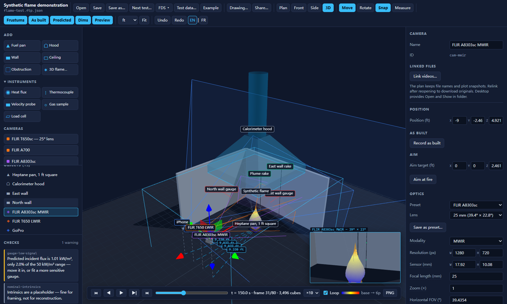
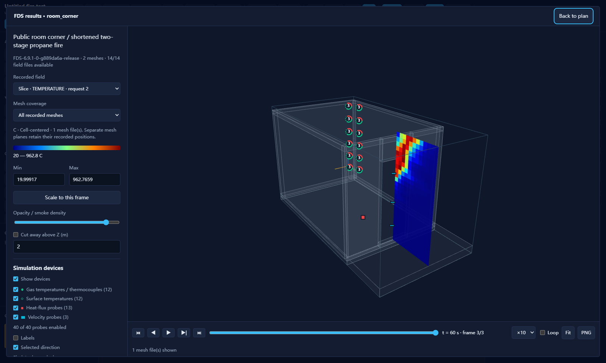

# FireTestPlanner

[](https://github.com/infinitr0us/FireTestPlanner/actions/workflows/ci.yml)
[](https://github.com/infinitr0us/FireTestPlanner/releases/latest)
[](LICENSE)

Plan a fire test in 3D. Lay out the burner, hood, walls, cameras and instruments, check
that every camera and sensor will actually capture what it is there for, and hand the
result on as one diffable file.



The file is the product. A fire safety engineer authors a `.ftp.json` plan in the
editor; a data scientist reads the same file as a camera rig description with the
`fireplan` Python package. Everything else here serves that handoff.

## Features

- **3D layout editor.** Cameras, a burner, a calorimeter hood, walls, ceilings,
  obstructions, heat flux gauges, thermocouples (one bead or a rake), velocity probes,
  gas sampling points and load cells, in plan, orbit and elevation views, stored in SI
  and displayed in metric, decimal feet or feet and inches.
- **Checks that answer the planning questions.** Each camera's frustum, live preview,
  field of view, standoff, mm/px at the fire, and whether the flame base, tip and plume
  are in frame and not hidden behind a wall. Each gauge's predicted incident flux
  against its range and noise floor, scaled by how much of the flame it can see; each
  thermocouple bead's predicted plume temperature; hood capture and ceiling clearance;
  all from standard fire correlations (Heskestad).
- **Fires that change.** A heat release rate curve on the burner (t² growth, a pasted
  table, an FDS ramp or a measured series) and a fire clock that plays the predicted
  flame through it. Checks judge the peak.
- **Camera presets** derived from manufacturer datasheets, including the FLIR A8303sc
  and A700 with a choice of lenses and a lens comparison, plus presets of your own.
- **Drawings a crew can build from.** A dimensioned plan and elevations with doors and
  windows, an equipment list, a set-out table of coordinates and aim points, a
  planned-against-measured check once positions are surveyed, and an instrument schedule
  (CSV), ready to print to PDF.
- **Share.** One self-contained HTML file with the plan baked in: a collaborator
  double-clicks it and orbits the scene with nothing installed.
- **FDS both ways.** Build a plan from an [FDS](https://pages.nist.gov/fds-smv/) input
  file (walls, ceilings, obstructions, the burner and its heat release curve, doorways,
  and the devices that correspond to real instruments), and write the plan's
  instruments back as `&DEVC` lines.
- **FDS results playback.** Replay slices, boundary maps, Smoke3D and device histories
  of a completed simulation, including multi-gigabyte runs, read frame by frame.
- **Measured and simulated data on the instruments.** Link a logger workbook, a CSV or
  an FDS device file, map its columns to the instruments, and plot each instrument's
  measured and simulated series against the plan's prediction.
- **After setup.** Record each object's as-built position beside the planned one, and
  start the next test of a series from the same rig.
- **Reconstructed flame playback.** Play a visual-hull reconstruction (one voxel file
  per timestep) inside the layout, against the predicted flame.
- **English and French.** The editor, its checks and the printed drawing switch
  between English and (draft) Canadian French; plans and exported files are the same
  in either.
- **`fireplan` for Python.** Intrinsics and extrinsics in the OpenCV frame (planned or
  as built), the same checks, instrument series, nerfstudio export, FDS conversion and
  flame sequences.

## Download

From the [latest release](https://github.com/infinitr0us/FireTestPlanner/releases/latest):

| File | What it is |
|---|---|
| `FireTestPlanner.exe` | The desktop app for Windows 10 and 11: native file dialogs, recent files, and opening linked files in their default programs. It uses the Microsoft Edge WebView2 runtime that Windows 11 already includes. |
| `FireTestPlanner.html` | The same editor as one offline HTML file. Open it in a current Chrome or Edge; nothing to install. |
| `fireplan-<version>-py3-none-any.whl` | The Python reader: `pip install fireplan-<version>-py3-none-any.whl`. |

The executable is not code-signed, so Windows SmartScreen may warn the first time it
runs (**More info**, then **Run anyway**). Each release lists SHA-256 checksums of its
files.

## Try it

Open the app and click **Example**. It loads the reference layout, a four-camera row
under a calorimeter hood, with a synthetic 80 kW design fire on its 1 ft pan, so press
play. Click a camera in the object list: the coverage panel and the picture-in-picture
preview show what that lens will actually get.

Select **East wall gauge** for the same argument about instruments. At 1.5 m from an
80 kW fire it sees 1.0 kW/m², which is 2% of a 50 kW/m² gauge and lost in its noise,
while the 10 kW/m² gauge further away on the north wall still reads above its noise
floor (0.6 kW/m², 6% of scale). The reference layout itself,
[`fixtures/pool-fire-camera-row.ftp.json`](fixtures/pool-fire-camera-row.ftp.json),
keeps the 130 kW steady-state figure for a 1 ft pan.

## Using it

### What you can put in a plan

Cameras, a burner, a calorimeter hood, walls, ceilings, **obstructions** (the box that
is neither), **heat flux gauges** and **thermocouples** (one bead, or a rake of them on
one support). Cameras carry a zoom factor as well as a lens, and every instrument is
checked against the fire it is pointed at rather than merely placed.

### Cameras this build has never heard of

The preset list is seeded from [`presets/cameras.json`](presets/cameras.json), which
includes the FLIR A700, A8303sc, K65 and ONE Pro, derived from the documents listed in
[`docs/datasheets/`](docs/datasheets/README.md), and nominal presets for a Canon VIXIA
HF R50 and an iPhone X whose derivations are written out there too. The A8303sc and
the A700 are each listed once, placed with the 25 mm and the 24° lens; the **Lens**
field in the inspector switches between the lenses FLIR prints for the body (17, 25,
50 and 100 mm for the A8303sc; 6°, 14°, 24°, 42° and 80° for the A700), keeping the
camera's position, aim and zoom. Below Coverage, a **Lens comparison** shows each lens fitted where the camera
stands: its field of view, the detail at the fire in mm/px, and how much of the flame
envelope stays in frame.

For anything else, place the nearest camera, correct its optics in the inspector, then
**Save as preset**. It joins the list and persists (in the desktop app's settings
file, or in site data in a browser tab) with **no file to keep beside your plans**.
That works because `presetId` is only a hint: every intrinsic is copied inline into
the camera, so a plan is fully specified on a machine whose preset library is empty,
and opening someone else's plan offers to adopt the preset it names.

### Drawing and Share

**Drawing…** produces the dimensioned plan and elevations with an equipment list and
coverage table, ready to print to PDF. Doors and windows are cut out of their walls and
dimensioned, and a **Set-out** table gives every object's coordinates from the burner
centre, its aim point, a camera's standoff and a gauge's facing in words ("toward -X,
6° down"), in the plan's display unit: choose **ft-in** for feet and inches to the
nearest 1/16". **Download schedule (CSV)** lists every gauge, bead, probe and camera with
its position and the logger channel mapped to it, for wiring. **Share…** writes a copy
of the single-file editor with the current plan baked in.

### Starting from an FDS model

**FDS ▾ › Import FDS…** in the toolbar builds a plan from a `.fds` input: walls, ceilings, boxes, the burner
and its heat release, doorways from `&HOLE`, and the `&DEVC`s that correspond to
instruments someone has to mount. It previews what it will make and what it will skip
before anything is adopted, and it will not adopt a conversion the editor could not
open again.

A split input (geometry in one file, devices in another, pulled together by `&CATF`)
imports whole: the desktop app reads the sibling files from the folder the input came
from. A browser tab only has the one file it was handed, and says which files it could
not read rather than presenting part of a model as all of it.

```bash
python -c "from fireplan import Plan; Plan.from_fds('fixtures/fds/room_corner.fds')"
```

The sample in `fixtures/fds/`, an ISO 9705 style room corner case written for this
repository, converts to 4 walls with a door, a ceiling, a 300 kW burner and 17
instruments. The plan's own checks immediately report that the mean flame tip comes
within 0.01 m of the ceiling and that four gauges sit inside the near field, which is
the point of importing it here rather than reading it there.

The origin moves: this format measures everything from the burner centre at floor
level, so an import re-origins and keeps the shift in `meta.source.originOffset_m`.
The inspector's **Fields / FDS** switch uses it to show a wall as the `XB` the source
file actually contains, and accepts one typed back. **From FDS** in the palette turns
a single pasted `&OBST` or `&DEVC` into an object.

`fdsreader`, the obvious library, does not help here: it reads simulation *output*
through the `.smv` file and cannot open a `.fds` input. The reader is ours, and small.

### Playing back FDS simulation output

**FDS ▾ › FDS results…** opens a separate results workspace. In the desktop app, select the
simulation's `.smv` file; in the browser, choose its output folder. The viewer reads
individual frames locally, including multi-gigabyte simulations, without importing
those results into the editable plan.

Replay temperature and velocity-component slices, wall temperature and heat flux maps,
quantized 3D smoke and fire previews, and device and HRR histories. Controls include
play and pause, frame stepping, scrubbing, playback speed, mesh selection, stable
colour scales, an adjustable cutaway for interior surfaces, and a labelled PNG
snapshot. Simulation probes have type filters, optional labels, recorded direction
arrows, and a chooser for overlapping positions. Selecting a probe opens its recorded
history; the PNG snapshot includes the visible probe markers.



The results example is that same room corner case, run in FDS 6.9.1 (two meshes, 61
recorded frames). Three of its frames, extracted byte for byte, are in
`fixtures/fds-results/` and keep the regression tests reproducible;
`tools/build_fds_results_fixture.py` rebuilds them from a fresh run. See [supported outputs, usage and limitations](docs/fds-results.md).
Results stay external: plan Save and Share do not embed the simulation output.

### Connecting the plan to recorded test data

Select a burner, camera or sensor and use **Linked files** in its inspector. Cameras
link videos; burners, heat flux gauges and thermocouple rakes link spreadsheets. The
desktop app provides **Open**, **Show in folder** and **Relink**. Save As preserves
the targets, and moving a plan together with its data folder preserves relative links.

A burner CSV with `timestamp_s`, `volume_m3` and `surface_area_m2` columns produces
two aligned plots in the upper right of the viewport, with a shared sample slider. The
snapshot travels inside the plan and shared HTML; originals stay external. See the
[usage guide](docs/linked-files.md), or open
[`linked-test.ftp.json`](fixtures/linked-files/linked-test.ftp.json) for a working
example with a synthetic CSV and a short test-pattern video.

### Measured and simulated data on the instruments

**Test data…** links a file a test or a simulation produced: a data-logger workbook
(`.xlsx`, including the raw logger sheet with a time column per channel and
hand-processed sheets with several header rows), a CSV, or an FDS `_devc.csv` /
`_hrr.csv`. It shows how the file was read, offers the ignition time written in the
workbook's processed sheets, and maps columns to gauges, thermocouple beads, probes,
gas points, load cells and burners. A gauge logged in volts takes its calibration
constant from the channel name (`..._23.17kW/m2permV`), and an FDS run of a plan
exported to FDS maps itself by device name. Selecting an instrument then plots its
measured series (solid), its simulated series (dashed), the plan's prediction and the
gauge's range, against seconds from ignition. The plan records the mapping, never the
samples; **Share…** embeds them. See [docs/test-data-design.md](docs/test-data-design.md).

### A fire that changes

A burner's heat release rate can be a curve: **Curve** in its inspector makes one from
t² growth (slow to ultra-fast), a table pasted from a spreadsheet, or a mapped HRR
series, and an FDS import keeps the input's `RAMP_Q` or `TAU_Q`. Checks still judge the
peak. A plan with a curve gets a fire clock on the playback bar that plays the predicted
flame through it, and the instrument plots draw the prediction as a curve.

### Writing the instruments back to FDS

**FDS ▾ › Export to FDS…** writes the plan's gauges, thermocouple beads, velocity probes and gas
sampling points as `&DEVC` lines, in the source FDS file's frame and under its device
IDs when the plan came from an import. Wall-mounted gauges and surface thermocouples
get their `IOR`. Geometry is not written: a model needs a mesh and surfaces the plan does
not hold. FDS 6.9.1 accepts the result (`tools/check_fds_device_export.py`).

### After setup: as built, and the next test

**Record as built** in any object's inspector stores where it was actually set up,
beside the planned position, and says how far off it is; **As built** in the toolbar
shows the surveyed positions as ghosts, and the drawing adds a planned-against-measured
table for sign-off. In Python, `cam.extrinsics(pose="best")` uses the surveyed pose.
**Next test…** saves a copy for the next test of a series (the next test ID, the same
rig) without the previous test's data.

### In French

**EN | FR** at the end of the toolbar switches the editor, its check messages and the
printed drawing to French, with decimal commas; number fields accept either a comma
or a point. The choice is remembered for you (in the desktop app's settings, or the
browser), not stored in the plan, so a plan opens the same for a colleague working
in English. Names and notes you type, file names, FDS keywords and check codes stay
as they are. The French is a draft awaiting review by a francophone fire safety
engineer; [docs/french-review.md](docs/french-review.md) lists the terms to confirm.

### Playing back a reconstructed flame

A reconstruction pipeline that turns the cameras' footage into a visual hull writes one
`t_<seconds>s.npz` of occupied voxel centres per timestep (the format is defined in
[CONVENTIONS.md](CONVENTIONS.md) section 11). Link that folder with the **3D flame…**
tile, or **Link 3D flame sequence…** on the burner whose `volumes.csv` came from the
same run, and a playback bar docks along the viewport. The hull plays back inside the
layout, under the hood and inside the frustums of the cameras that produced it, with
the predicted Heskestad cone over it for comparison. The burner's volume plot follows
the same clock, and a selected camera's picture-in-picture shows the hull from its own
view at that moment.

The plan stores a reference and a manifest, never the voxels. The desktop app reads the
frames as the plan opens (from a network share only on **Load frames**, so opening a
plan never contacts another machine), and **Share…** embeds them in the exported page
(the Example's 80 frames are 64 KB packed). Placement checks say when a hull sits below
the floor or away from its burner, which means the reconstruction frame was not the
plan frame, and the object's transform is the correction. See
[docs/flame-playback.md](docs/flame-playback.md).

```python
from fireplan import Plan
plan = Plan.load("fixtures/flame/flame-test.ftp.json")
seq = plan.flame_sequence(plan.reconstructed_flames[0])
seq.voxels(55.0)                     # (25639, 3) centres at t = 55 s
```

## Read a plan in Python

```bash
pip install -e python/      # or just run pytest from the repo root
```

The wheel carries its own copy of the schemas (`fireplan/schemas/`, a byte-identical
mirror of `schema/` that a test holds it to), so `validate_schema()` and FDS
conversion work from an installed package with no repository checkout beside it.

```python
from fireplan import Plan

p = Plan.load("fixtures/pool-fire-camera-row.ftp.json")
cam = p.cameras["cam-lwir-t650"]

cam.K                       # (3,3) intrinsics in pixels
cam.extrinsics()            # (4,4) camera-to-world, OpenCV frame
cam.intrinsics_source       # 'nominal' | 'datasheet' | 'calibrated'

p.to_nerfstudio("transforms.json")
p.framing(cam)              # does this camera actually frame the flame?
p.check()                   # hood capture, instrument placement, plan hygiene

gauge = p.heat_flux_sensors[0]
p.heat_flux_estimate(gauge)          # predicted incident kW/m2, and whether it is usable
p.thermocouple_beads(p.thermocouples[0])   # each bead: flame / plume / outside, and its
                                           # predicted plume-centreline temperature
p.series(gauge)             # measured and simulated series mapped to it (format 1.6)
cam.extrinsics(pose="best") # the surveyed (as-built) pose when there is one
```

Before reconstructing from a plan, check `intrinsics_source`. `nominal` means the
numbers are a placeholder: good enough to check framing, not good enough to
reconstruct from. More in [python/README.md](python/README.md).

## Two things worth knowing

**The origin is the burner centre at floor level.** Camera standoff is therefore just
`norm(position)`, and the dimension callouts a hand sketch is covered in are generated
rather than drawn.

**Poses are stored in the OpenGL frame and read in the OpenCV frame by default.**
Storage matches the editor (Three.js), reading matches reconstruction tooling. Both
ends are explicit; neither has to remember the other's choice. Full definitions are in
[CONVENTIONS.md](CONVENTIONS.md) section 3.

## Build from source

The web editor needs Node 22; the Python package needs Python 3.9 or later.

```bash
cd web && npm install
npm run dev                 # open the local URL Vite prints
npm run build               # -> dist/index.html, one self-contained file
```

The desktop app carries `web/dist/index.html` as bundled data, so rebuilding the exe
means rebuilding the web bundle first; packaging around a stale bundle looks exactly
like a code change simply not working. On Windows, `build.bat` does the whole chain:

```bat
build.bat                   :: web bundle -> exe -> selftest
build.bat clean test        :: both suites first, then a clean package
build.bat console           :: console variant, so --selftest prints to a terminal
build.bat noverify          :: skip the post-build selftest
```

It creates `python/shell/.venv` and runs `npm install` on first use, stops on the first
failure rather than shipping a broken build, and finishes by running the packaged exe's
own `--selftest`. Output lands in `python/shell/dist/FireTestPlanner.exe` (about 10 MB).
The steps by hand:

```bash
cd web && npm run build                         # the bundle the exe will carry
cd ../python/shell
python -m venv .venv
.venv\Scripts\python.exe -m pip install -r requirements.txt
.venv\Scripts\python.exe app.py                 # run from source
.venv\Scripts\python.exe build_exe.py           # -> dist/FireTestPlanner.exe
```

The desktop app is the same bundle in a native window (pywebview on WebView2), with
native file dialogs, a **Recent…** list and a prompt before closing over unsaved
changes. See [`python/shell/README.md`](python/shell/README.md) for how the bridge
works and why it is HTTP rather than pywebview's `js_api`.

## Example data

Everything under `fixtures/` is synthetic or was written for this repository, and can
be regenerated:

| Data | Source |
|---|---|
| `pool-fire-camera-row.ftp.json` | The reference layout, built by `tools/build_fixtures.py` from a hand sketch of a test setup. |
| `flame/` | A synthetic 80 kW design fire (80 visual-hull frames and their `volumes.csv`), generated by `tools/build_synthetic_flame.py`. |
| `linked-files/` | A synthetic CSV from the same generator and a 6 s test-pattern video. |
| `fds/room_corner.fds` | An ISO 9705 style room corner case written for this repository (geometry after NISTIR 5904), and its conversion. |
| `fds-results/` | Frames 0, 30 and 60 of that case's FDS 6.9.1 run, extracted byte for byte by `tools/build_fds_results_fixture.py`. |

The tool was developed and validated against real test data and simulations supplied
by fire safety engineers; that data is not distributed.

## Documentation

- [CONVENTIONS.md](CONVENTIONS.md): the normative rules of the plan format: frames,
  units, correlations, versioning, FDS mapping, linked files and flame sequences.
- [schema/](schema/): one JSON Schema per format version, 1.0.0 to 1.6.0.
- [docs/visual-language.md](docs/visual-language.md): colours, labels, transport
  controls and print palette, and the checklist for any new UI.
- [docs/fds-results.md](docs/fds-results.md), [docs/linked-files.md](docs/linked-files.md),
  [docs/flame-playback.md](docs/flame-playback.md): feature guides.
- [PLAN.md](PLAN.md): milestones, decisions and known limitations.
- [CHANGELOG.md](CHANGELOG.md): what changed in each release.

## Development

[CONVENTIONS.md](CONVENTIONS.md) defines plan data and interchange behaviour.
[Visual language](docs/visual-language.md#developing-a-new-feature) defines the design
requirements for every new or changed UI, scene, plot and exported figure. Apply its
workflow before implementation and its checklist before completion; visual consistency
belongs in the feature's own work.

Reuse shared colours, device identities and transport controls. Extend their shared
definitions when a new meaning is needed, and document justified differences in the
visual-language exceptions table in the same change. Repository automation
instructions in [AGENTS.md](AGENTS.md) point to the same reference.

For web code changes, run `npm test` and `npm run build` in `web/`. For visual or
interaction changes, also run `npm run test:browser` (which includes the build), extend
coverage for the new path, and inspect the affected UI states. See
[browser checks](web/browser-tests/README.md) for setup and coverage boundaries. Use
`build.bat` when handing off an updated desktop executable; its startup self-test is
separate from interaction and native file-dialog checks.

### Tests

```bash
python -m pytest python/tests -q     # Python suite, no GUI needed
cd web && npm test                   # web unit suite
npm run build                        # TypeScript + single-file bundle
npm run test:browser                 # build + DOM/WebGL and real input checks
```

The web suite asserts that the TypeScript writer reproduces the Python-written fixture
byte for byte, that the TypeScript flame reader produces the manifest, the packed
bytes and the surface cells the Python reader pinned on the 80-frame fixture, and that
the TypeScript FDS importer reproduces the Python-written conversion of the FDS sample
the same way. Two importers that agree about the syntax but not about which box is a
wall would hand an engineer and a data scientist two different rooms from one file. A
plan saved from the editor and the same plan saved from `fireplan` must be the same
file, or every handoff shows up as a spurious diff. The instrument models are pinned
against hand-derived values in both languages, so the number the tool prints stays the
number the correlation gives.

## License

[MIT](LICENSE). The release binaries include third-party components under their own
licenses, listed in [THIRD_PARTY_NOTICES.md](THIRD_PARTY_NOTICES.md). FDS and
Smokeview are developed by NIST and VTT; this project reads their file formats and is
not affiliated with them. Manufacturer datasheets are referenced, not redistributed.
